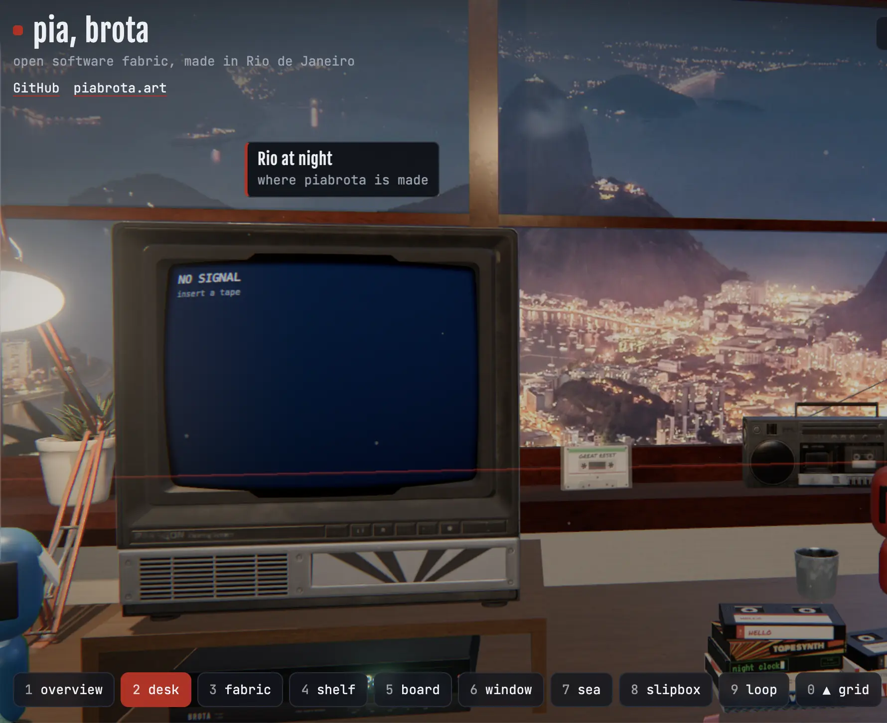
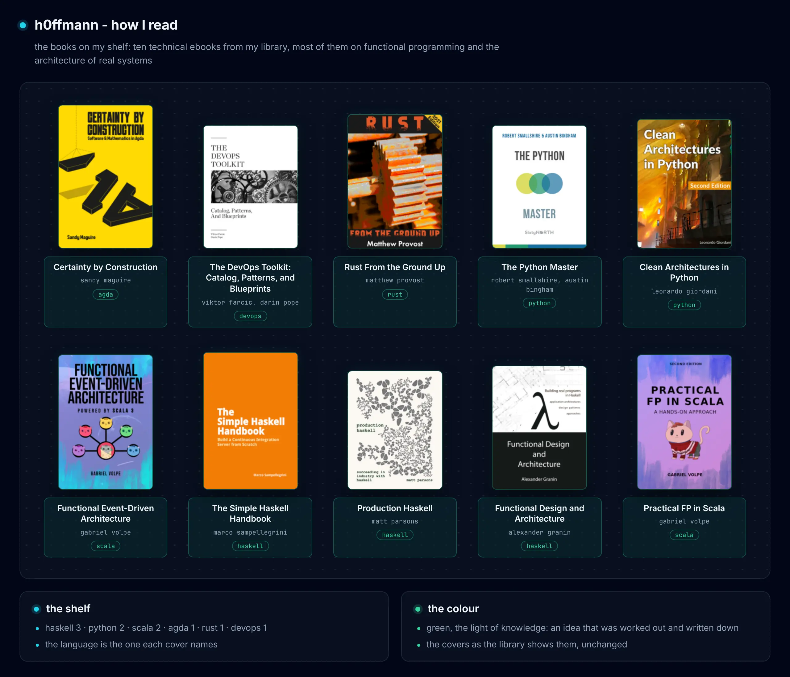
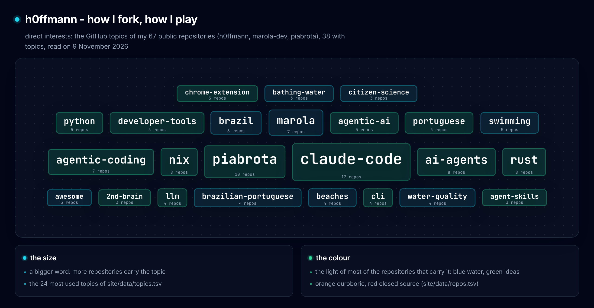
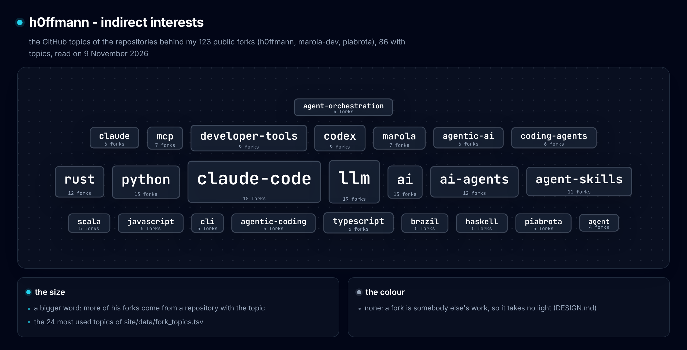

<a href="https://github.com/h0ffmann/h0ffmann/blob/main/llms.txt">llms.txt</a>: an index of my work for language models · CV: <a href="pdf/Matheus_Hoffmann_CV_2026-11.pdf">English (PDF)</a>, <a href="pdf/Matheus_Hoffmann_CV_2026-11.ja.pdf">日本語・簡易版 (PDF)</a>

<i>And what is good, Phaedrus, And what is not good— Need we ask anyone to tell us these things?</i>

Robert M. Pirsig, <i>Zen and the Art of Motorcycle Maintenance</i> (1974), the epigraph on its opening page

**Staff Software Engineer & FDE** 31yo

**Piabrota AI Studio (self-employed, since October 2026)**
- [room.piabrota.art](https://room.piabrota.art): a 3D room (JavaScript, Spotify).
- [metrics.piabrota.art](https://metrics.piabrota.art): Piabrota infrastructure numbers.
- [grid.piabrota.art](https://grid.piabrota.art): unstructured grids of the Brazilian coast.
- [skills.piabrota.art](https://skills.piabrota.art): a skill collection.
- [pirsig.piabrota.art](https://pirsig.piabrota.art): a second brain. (obsidian-like)
- [proof.piabrota.art](https://proof.piabrota.art): Lean 4, Z3 and other formal verification tools -- agda soon
- Partnerships or white-label requests: whitelabel [at] piabrota.art

**Technical skills and background**
- Software development: 10+ years. Mostly Scala for backend and data; Python for ML and Airflow.
- 2015: LIOC, ocean instrumentation lab. FPGA signal processing in LabVIEW (low code) for Brazilian Navy underwater communication.
- 2016: [LIOC](http://www.lioc.oceanica.ufrj.br/) (in Portuguese). Real-time GPS boat tracking over 2G, with mobile phone chips.
- 2017: [StoneCo](https://www.stoneco.com.br/), during its IPO. Churn prediction with XGBoost, to replace Bayesian networks.
- 2018: a model that recommends a mobile carrier from ping history. Flink (alpha stage) detects events; Python scores.
- 2019: a pre-seed startup. [We made an instant transfer between banks](https://www.cnnbrasil.com.br/economia/seu-bolso/meu-dinheiro/guiabolso-se-antecipa-ao-pix-com-transferencias-bancarias-instantaneas/). It launched in August 2020, before Pix. A company bought us; then Pix made the product unnecessary.
- \[UK\] 2020: an early startup based in [London](https://www.ycombinator.com/companies/broad), in overseas banking. I worked mainly on the Scala backend and the FX APIs.
- \[US\] 2021: a California startup. [Semantix](https://valor.globo.com/empresas/noticia/2023/01/05/semantix-compra-a-startup-americana-elemeno-em-sua-primeira-aquisicao-internacional.ghtml) bought it.
- \[US\] 2022: promoted to Lead MLOps, consulting for Americanas (B2W, Brazil). ML environments with Kubernetes and Kubeflow.
- \[US\] 2023 to 2024: fraud prevention on Databricks. L5 engineer and SME of a loss forecasting product. I reported to the CFO. "Values VIP: Tenacious" award, [February 2024](https://www.linkedin.com/in/mhoffmannbr/overlay/Honor/296067482/treasury/?profileId=ACoAABRG_1kBEWvIwVR2h1bvBys5jFmEBGGv4rw).
- \[UK\] 2025: [TV](https://www.itv.com) audience forecasts for 4 channels, indirect contract. AWS: SageMaker, MWAA, S3, Lambda and Step Functions.
- \[UK\] 2026: I redesigned, with DS Lead, all 34 long-term models (2 channels × 17 demographics) as heuristic rules. I took them to production on AWS (SageMaker, MLflow). I resigned on early September 2026.

**Research: UFSC, until mid-2027**
- A team of 5 persons ([ondaseventos.ufsc.br](https://ondaseventos.ufsc.br)).
- I port the WAVEWATCH III (WW3) ocean wave model from old Fortran to C++ (Kokkos and CUDA). Rust may follow, with help from Prof. Pedro Veras (LabECO). The goal: WW3 runs faster on GPUs and gives the same results as the Fortran. Bit-for-bit parity where possible; the physics stays consistent.
- My works with a DOI: marola ([10.5281/zenodo.23224155](https://doi.org/10.5281/zenodo.23224155)), ww3-gpu ([10.5281/zenodo.23221351](https://doi.org/10.5281/zenodo.23221351)), picasso ([10.5281/zenodo.23311208](https://doi.org/10.5281/zenodo.23311208)), closed source ([10.5281/zenodo.23333656](https://doi.org/10.5281/zenodo.23333656)), marola-bench ([10.5281/zenodo.23352633](https://doi.org/10.5281/zenodo.23352633)), nashkell, the open book ([10.5281/zenodo.23356739](https://doi.org/10.5281/zenodo.23356739)).

**Misc**
- AWS: 4 certifications.
- PADI Rescue Diver: 4 scuba diving certifications.
- Open water: 2 Oceanman 10 km swims, 2025 (Salvador, Rio).

  

<a href="https://room.piabrota.art">room.piabrota.art</a>, the piabrota room (<a href="https://github.com/piabrota/room">piabrota/room</a>) · Rio at night in the window: "Rio de Janeiro at night from above" by Wilfredor, Wikimedia Commons, <a href="https://creativecommons.org/publicdomain/zero/1.0/">CC0 1.0</a>

  

how I read: ten books from my ebook library, the covers as their publishers made them

  

direct interests: the topics of <a href="site/data/repos.tsv">my repositories</a> (<a href="site/data/topics.tsv">the index</a>)

  

indirect interests: the topics of what <a href="site/data/forks.tsv">my public forks</a> come from (<a href="site/data/fork_topics.tsv">the index</a>) · drawn with <a href="https://github.com/tt-a1i/archify">Archify</a>; <code>just topics</code> draws both again

