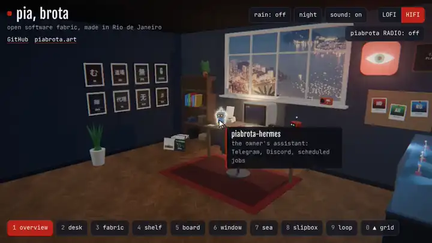
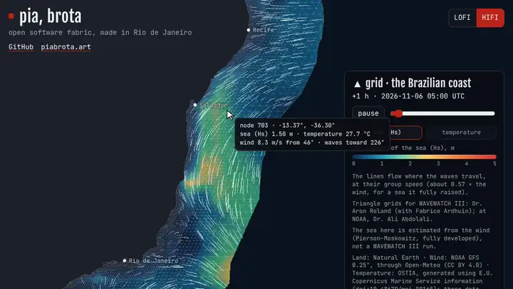

<i>And what is good, Phaedrus, And what is not good— Need we ask anyone to tell us these things?</i>

Robert M. Pirsig, <i>Zen and the Art of Motorcycle Maintenance</i> (1974), the epigraph on its opening page

software engineer · open water swimmer · open2work

currently volunteering at Federal Univ. of SC (UFSC) ([ondaseventos.ufsc.br](https://ondaseventos.ufsc.br)), accelerating ocean models by porting the Fortran WW3 physics model to Rust/C++ · building Brazilian disaster extensions for AstrBot's [disaster warning plugin](https://github.com/Pancakes-Labs/astrbot_plugin_disaster_warning): [br_south_disaster](https://github.com/h0ffmann/astrbot_dw_ext_br_south_disaster), [br_south_waterq](https://github.com/h0ffmann/astrbot_dw_ext_br_south_waterq) (work in progress)

mhoffmannfs [at] gmail.com · [linkedin.com/in/mhoffmannbr](https://www.linkedin.com/in/mhoffmannbr/) · [medium.com/@mhoffmann](https://medium.com/@mhoffmann)

- [piabrota org](https://github.com/piabrota/nix-os): FOSS fic company where I code and research with [omp](https://github.com/can1357/oh-my-pi), [Hermes](https://github.com/nousresearch/hermes-agent) and [OpenRig](https://github.com/mvschwarz/openrig). org toy [website](https://piabrota.art)
- [marola-dev org](https://github.com/marola-dev): FOSS non-profit work associated with [Leave No Trace](https://lnt.org)

  

<a href="https://room.piabrota.art">room.piabrota.art</a>, the piabrota room (<a href="https://github.com/piabrota/room">piabrota/room</a>) · Rio at night in the window: Wilfredor, <a href="https://creativecommons.org/publicdomain/zero/1.0/">CC0 1.0</a>

  

▲ grid, key 0 in the room: a triangle mesh of the Brazilian coast, 24 h of sea and wind · wind: NOAA GFS through <a href="https://open-meteo.com">Open-Meteo</a>, <a href="https://creativecommons.org/licenses/by/4.0/">CC BY 4.0</a> · temperature: OSTIA, generated using E.U. Copernicus Marine Service information (<a href="https://doi.org/10.48670/moi-00165">doi:10.48670/moi-00165</a>) · land: Natural Earth

  

direct interests: the topics of <a href="site/data/repos.tsv">my repositories</a> (<a href="site/data/topics.tsv">the index</a>)

  

indirect interests: the topics of what <a href="site/data/forks.tsv">my public forks</a> come from (<a href="site/data/fork_topics.tsv">the index</a>) · drawn with <a href="https://github.com/tt-a1i/archify">Archify</a>; <code>just topics</code> draws both again

